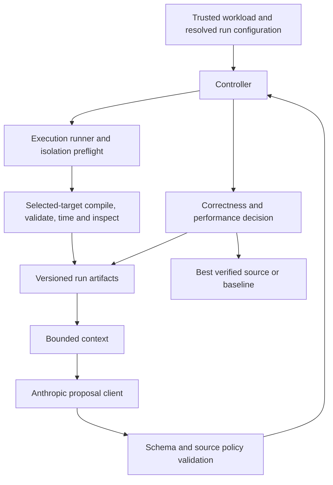

# Agentic AI Compiler — general implementation roadmap

Version **AIC-1.1**, 2026-10-12. **APPROVED** by the owner on 2026-10-12.
No implementation milestone is authorized. Overall plan approval is recorded as
PLAN-APPROVAL in [IMPLEMENTATION_PROGRESS.md](IMPLEMENTATION_PROGRESS.md);
subsequent milestone authorization and implementation evidence belong there too.

## 1. Executive decision and scope revision

Build the whole Ericsson Agentic AI Compiler project: trusted workloads and
measurements; compiler/profile context; a safe iterative LLM optimizer; custom
kernels; algorithm and model rewrites; controlled evaluation; reproducible delivery.
Keep XLA as compiler and reuse the existing flat Python modules, injectable
provider client and atomic JSON pattern.

**Owner revision, 2026-10-12:** “general, hardware-neutral roadmap for the entire
project.” This supersedes the CPU-first restriction and CPU-only completion scope
of the earlier master request and unapproved CPU-1.0 draft. Planning-only work,
correctness standards and explicit milestone approvals remain in force. The
current task is to revise documentation, not to implement the system.

Hardware-neutral means the goals and controller are independent of the hardware
choice. Select and validate **one primary target** in M1 using actual availability,
profiling, isolation, kernel feasibility and cost. CPU, GPU and TPU are candidates;
none is assumed available or selected. Supporting all three is not a prerequisite.
A second target is optional M8 work after the main project, using evidence from a
real second implementation before introducing shared backend abstractions.

External source: **projects2026.pdf, page 1, Project 1: Ericsson**, fingerprinted
in [CODEBASE_AUDIT.md](CODEBASE_AUDIT.md). It requires iterative JAX/XLA optimization,
lowered-program/runtime feedback, high-level rewrites, custom kernels, correctness,
measurable improvement against vanilla XLA and progression toward full models.
Hardware choice is open in that specification. The old LaTeX plan is design
history; latest explicit owner direction determines the revised project scope.

Verified repository evidence remains CPU-specific: an addition example runs;
limited correctness checks and warmed timing work; fake-provider feedback/history
works. JAX 0.4.38 IR/trace APIs were probed on CPU only. No GPU/TPU, live provider,
safe sandbox, clean install, native kernel or credible speedup has been verified.
These observations support reuse, not cross-hardware claims. No source changes or
new hardware experiments were made in this roadmap revision.

## 2. Scope and success

| Level | Required outcome | Boundary |
| --- | --- | --- |
| A — functional optimizer | Through M3: one workload on the selected target; baseline, multi-case correctness, calibrated synchronized timing, compiler summary, measured runtime/profile coverage, validated proposals, isolated evaluation, >=2 live feedback-informed iterations, durable history and best verified source. | Fake tests complement genuine LLM evidence. No speedup required to establish loop functionality. No silent device fallback. |
| B — complete project target | Through M7: representative primitives/compound operations, actual agent custom-kernel capability on the selected target, attention and Transformer progression, one compact complete model forward pass, held-out evaluation, controlled research, failure analysis, recovery, report and demonstration. | Kernel/model implementation are planned main-project deliverables. Deferral requires an explicit scope amendment and leaves the corresponding Ericsson requirement incomplete. Performance success is separately assessed and cannot be promised. |
| C — extensions | M8 second-target replication; later larger production models, gradients/training, additional providers or advanced search if separately scoped. | Not dependencies of A/B; no simultaneous three-backend implementation or large-model requirement for the first complete system. |

Forward pure JAX functions are the initial contract. Exclude replacing XLA,
mandatory HLO mutation, distributed training, arbitrary Python applications,
precision-changing approximations, services, orchestration frameworks, databases
without demonstrated need and sophisticated search before the basic loop works.
A compact complete model establishes bounded whole-model rewriting, not a claim
of production LLM training/inference coverage. Team size, hours and dates remain
unknown; use relative effort and gates, not invented deadlines.

## 3. Architecture and data flow

The diagram is logical: generated Python never executes in the controller.
Reference generation and acceptance are trusted responsibilities; candidates
cannot choose their inputs, tolerance, timing protocol or decision.

| Existing / proposed path | Contract and reason |
| --- | --- |
| `agent.py` (existing) | Keep CLI and provider wiring. Add explicit `baseline`, `optimize`, `report` modes without breaking documented options during migration; baseline/help/fake mode require no key. Validate budgets and selected device before any call; fail if the requested backend is unavailable. |
| `controller.py` (existing) | Current-best orchestration, bounded context selection and decisions; delegate numerical work and storage. Preserve public behavior where safe; constructor becomes side-effect free, baseline initialization explicit. |
| `benchmark.py` (existing) | Trusted numerical comparator, lowering/compilation timing, synchronized measurement and statistics. Separate `evaluate_callable` from candidate loading; no raw generated `exec` here in the controller path. |
| `workloads/example.py` (existing), `workloads/registry.py`, `workloads/softmax.py` (new) | Small immutable workload records and input factories. New modules avoid hard-coding workload rules into the controller. Later `layer_norm.py` and `matmul_gelu.py`. |
| `contracts.py` (new) | Versioned dataclasses/JSON validation for run configuration, proposal and evaluation; one shared contract boundary, not one class hierarchy per subsystem. |
| `runner.py`, `worker.py` (new) | Host lifecycle/containment and a minimal evaluation worker for the selected target. Implement one verified execution boundary chosen in M1/M2; trusted local subprocess mode remains limited to reviewed fixtures. |
| `feedback.py` (new) | Jaxpr/StableHLO/HLO extraction, optional estimates, trace capture and concise provenance-tagged summaries. |
| `storage.py` (new) | Unique run directories, per-attempt commits, derived history, source hashes, final-best export and safe resume. Extend current atomic-file pattern. |
| `tests/` (existing directory) | New pytest tests explicitly collected from here; no import of root interactive examples. |

`contracts.py`, runner, worker, feedback, storage and registry are proposed paths,
not existing features. No `src/` migration is needed. A reporting function in
`storage.py` and provider helper in `agent.py` suffice initially. Extract further
files only when responsibilities become hard to test separately.

### Contracts

- **WorkloadSpec v1:** ID, immutable reference source/hash, function name, pure
  input factory `(seed, shape, dtype)`, shape split, supported dtypes, explicit
  static parameters, output tree contract, per-leaf tolerance and nonfinite policy,
  edge-case factories and maximum input bytes. Legacy `TEST_ARGS` remains a
  trusted example adapter; guessed inputs are disallowed for scientific runs.
- **RunConfig v1:** selected backend/device and verified target configuration, workload/split, seeds, correctness policy hash,
  benchmark settings, runner/image identity, model parameters, all budgets and
  context condition. One JSON document resolved once from CLI/config overrides;
  precedence CLI > file > documented defaults. Record the resolved values.
- **Proposal v1:** `schema_version`, `parent_id`, `target='jax_rewrite'`,
  `hypothesis`, `transformation`, `rationale`, `expected_effect`,
  `candidate_source`, `constraints` and optional bounded notes. No file paths,
  shell commands or model-selected evaluation parameters. Expected effect is a
  hypothesis, never a measurement. Reject unknown fields and wrong types.
- **Evaluation v1:** candidate/source/input/environment identities; stage statuses;
  case-level shape/dtype/tree/finite/error results; lower/compile durations;
  raw timing blocks and summary; IR/profile references and coverage; bounded
  stdout/stderr; failure category. Unavailable values are null with reasons,
  never zero estimates. Nonfinite JSON numbers are rejected.
- **Attempt v1:** proposal, parent, timestamps, provider request/usage references,
  evaluator evidence, candidate terminal state, decision reason and budget debit.
  Evaluator reports cannot overwrite host-owned identity, correctness or decision.
- **Run result:** immutable baseline ID, current best ID, source export,
  correctness scope, baseline/incumbent comparisons, stop reason, remaining
  limitations and manifest. Never silently write the winner into user source.

Terminal candidate states: `PROPOSAL_INVALID`, `POLICY_REJECTED`,
`COMPILE_FAILED`, `EXECUTION_FAILED`, `TIMEOUT`, `RESOURCE_LIMIT`,
`CORRECTNESS_FAILED`, `MEASUREMENT_UNSTABLE`, `VALID_SLOWER`,
`VALID_NO_CHANGE`, `DUPLICATE`, `ACCEPTED`, `INTERRUPTED`. A no-output/refusal or
provider error is a request event, not a fabricated candidate. Baseline failure
stops the run before requesting proposals.

## 4. Correctness policy

The unmodified reference is frozen and compiled through ordinary `jax.jit` with
the same selected device, dtype, precision and XLA settings as candidates. Test the workload
reference itself against mathematical invariants and selected NumPy reference
calculations, so copying a flawed reference does not establish correctness.

Compare PyTree structure first, then leaf count, exact shape and dtype. Synchronize
all leaves with `jax.block_until_ready`; transfer values only outside timing.
Integer/bool outputs compare exactly. Float32 softmax starts with rtol `1e-5`,
atol `1e-6`; this is provisional until reference checks on extreme cases pass.
Layer norm and matmul/GELU set their own justified tolerances before search;
do not increase tolerances after inspecting a faster failing candidate. x64
is recorded explicitly; the initial float32 protocol preserves the selected target’s
reference semantics and matmul precision. No silent reduced-precision change.

Require finite outputs for finite-input workloads. Softmax tests include zeros,
equal logits, large finite positive/negative offsets, mixed magnitudes and one
dominant logit. Layer norm includes constant and nearly constant rows. If a future
workload intentionally returns infinities/NaNs, its contract must specify masks
and infinity signs explicitly; `equal_nan=True` is not a global default.

Search correctness: seeds 0–4 at two declared development shapes plus edge cases.
The exact arrays remain outside prompts. Final evaluation: at least 20 disjoint
seeds and two unseen shapes per research workload, frozen before search by the
trusted harness. Final seeds are not given to the provider, candidate source or
search artifacts. Release them with final results for reproducibility. A failed
held-out check invalidates generalization and performance claims for that scope;
do not feed it back and call a second attempt held out. New evaluation after
debugging requires a fresh split and version.

Report maximum absolute error, relative error with a documented near-zero
denominator rule, failed leaf/case and nonfinite masks. Compilation, execution,
structure and numeric failures are separate. Correctness is a hard gate before
timing; it is never traded for speed. Testing supports a specified domain and is
not a mathematical proof for all inputs.

## 5. Measurement and acceptance across hardware targets

Use unprofiled steady-state **end-to-end compiled JAX call latency**, including
dispatch and synchronization. This is not isolated machine-kernel time. Follow
JAX's asynchronous completion model and lower/compile separately; the installed
APIs were verified in D02/D03. See [JAX asynchronous dispatch](https://docs.jax.dev/en/latest/async_dispatch.html)
and [ahead-of-time compilation](https://docs.jax.dev/en/latest/aot.html).

1. Fix one measurement environment per experiment. Select the approved backend
   before importing JAX and verify actual devices; a missing requested device
   stops the run. Record hardware/OS/versions, lock hash, runner/image identity,
   CPU quota/affinity, accelerator model/topology and driver/runtime where relevant,
   an environment allowlist, thread settings, power state if observable and
   background-load observations. Do not dump the environment. No concurrent
   benchmark workers or compiler jobs. API calls and trace capture occur outside
   timing windows. Native macOS and container/VM timings are distinct populations.
2. Generate identical deterministic inputs outside timing; place/synchronize
   them first. Compile each shape/dtype separately. Record lowering and compile
   wall time and cache state independently. JIT caches may be warm for runtime;
   cold compilation comparisons need fresh processes and an explicit cache policy.
3. Warm each executable at least five times. Calibrate a common batch repeat
   count from the baseline only, with a target block duration of 10–50 ms and a
   hard repeat/time cap. Freeze it for candidate and incumbent. Synchronize every
   invocation. Tiny addition is a harness/dispatch check, not the headline result.
4. Collect at least 20 paired blocks in balanced randomized AB/BA order in a
   single otherwise idle session. Each block contains the same number of calls;
   retain total elapsed nanoseconds, repeat count, normalized latency, order and
   timestamps. Keep raw blocks, not just averages. Baseline/incumbent/candidate
   use identical runner settings and measurement code; container startup/imports
   and transport are outside the interval. No baseline on host versus candidate
   in container comparison; no baseline on CPU versus candidate on an accelerator.
5. Report median, mean, std, quartiles, min/max and IQR/median. Compute paired
   log runtime ratios and a fixed-seed bootstrap interval over **blocks**, not
   individual calls treated as independent. Store bootstrap configuration. Initial
   95% interval is a search filter, not proof after many adaptive trials.
6. Before search, perform at least five independent A/A sessions for each
   workload/search shape. Set minimum effect `delta` to at least the empirical
   95th percentile of absolute A/A median relative differences and timer resolution
   floor; freeze it in the protocol. Initially flag IQR/median >10% or interleaved
   baseline drift >5% as unstable. These are diagnostic starting limits: M2
   calibration may choose stricter/looser justified values before experiments,
   recorded and reviewed, never adjusted to accept a particular candidate.
7. If correct and stable, a candidate is provisionally better only if the lower
   bound on incumbent/candidate speedup exceeds `1 + delta`. Confirm in a second
   fresh measurement session against the incumbent before promotion; both sessions
   must meet the rule. Otherwise retain the incumbent and record `VALID_NO_CHANGE`
   or `MEASUREMENT_UNSTABLE`. Allow one fixed retry for unstable measurement; if
   still unstable, stop or reject, not unbounded reruns looking for a win.
8. Search ranking uses the declared primary development shape. Also record
   unmodified-baseline speedup; never compare against a stale best-ever fast
   sample. Final winner measurements use at least three independent fresh sessions
   against the original baseline on all declared evaluation shapes. Correctness
   and effect must reproduce. Report per-shape results and regressions; if claiming
   an aggregate, preregister equal-weight geometric mean and keep the full table.

Target-specific controls are selected and tested in AIC-031/005, not hard-coded
into the controller. CPU runs control thread contention and affinity where
possible. GPU runs record exact device allocation, precision, memory allocation
and driver/runtime; use an otherwise unshared device where feasible. TPU runs
record runtime/topology and allocation; start with one supported allocation,
not a distributed benchmark framework. Device transfer belongs outside the
steady-state metric and is also reported separately if application cost matters.
CUDA events or vendor counters may supplement end-to-end measurements only on a
verified compatible path; they never replace synchronized JAX timing for the
headline comparison. No cross-device ratio is an optimization speedup.

CPU thread control is host-specific. On Linux, fixed cpuset/cgroup allocation and
recorded threading configuration are preferred; verify what each selected flag
actually does in JAX 0.4.38. `OMP_NUM_THREADS` alone does not prove XLA thread
count. On macOS, record lack of affinity control and use an idle host with repeated
sessions. Do not insert guessed XLA flags that could abort initialization.

No universal 2% threshold is adopted. If A/A is too noisy, increase block duration
within the budget or choose a larger declared shape before search. If still
unstable, the workload is unsuitable for a performance claim on that host. Final
confidence intervals describe measured variability, not immunity to selection
bias; holdout/session confirmation and all-attempt reporting address that risk.
Compile and optimization cost are separate metrics; optionally report amortization
calls as total extra optimization time / per-call time saved only when positive.

## 6. Compiler and runtime profiling feedback

Probe the following paths on the selected target. They were demonstrated only
on the audited CPU environment in D03: `jax.make_jaxpr`,
`jax.jit(fn).lower`, `lowered.compiler_ir('stablehlo')`,
`lowered.compiler_ir('hlo').as_hlo_text()`, `lowered.compile().as_text()`,
`compiled.cost_analysis()` and `compiled.memory_analysis()`. Handle list/dict
cost results and unavailable fields explicitly. Store raw artifacts for baseline
and evaluated candidates under a byte cap. Summaries include shapes/dtypes and
conservative counts of dots/reductions/transposes/broadcasts/custom calls/fusions,
with representation name and parser version. Counts from text are indicative,
not a semantic optimizer or proof of fusion profitability.

Maintain four separate namespaces: `runtime_measurements` (actual wall times),
`compiler_cost_estimates`, `compiler_memory_estimates`, `runtime_trace` (observed
events). Zero temporary bytes from XLA is not measured zero process memory.

Initial profiler candidate: `jax.profiler.trace(..., create_perfetto_link=False,
create_perfetto_trace=True)` after compilation/warmup, separate from benchmark.
D04 demonstrated CPU events without TensorBoard installation. Parse the gzip JSON
with standard library tools, retaining event names, thread IDs, durations,
annotation intervals and coverage. Nested/overlapping events cannot be summed
into independent percentages. Aggregate only comparable non-overlapping intervals;
label exclusive versus inclusive durations. Do not equate host dispatch events
with individual JAX operations. Documentation describes trace capture and custom
annotations; actual pinned capabilities remain the acceptance test.
([JAX trace API](https://docs.jax.dev/en/latest/_autosummary/jax.profiler.trace.html),
[profiling guide](https://docs.jax.dev/en/latest/profiling.html))

Profile coverage states: `CPU_EXECUTION_EVENTS`, `DEVICE_EXECUTION_EVENTS`,
`HOST_ONLY`, `UNAVAILABLE`, each
with reason, backend/version and artifact reference. Reprofile baseline and a
promoted incumbent; rejected candidates retain runtime/IR and optional traces
within budget. Linux `perf` may later supply sampled stacks/counters but needs
permissions, symbol attribution and platform-specific analysis; it is not a core
dependency. macOS Instruments is useful manual corroboration, not a proposed
portable automated backend. XProf is an optional viewer/analysis addition, not a
new dependency merely to produce a trace.

Fallback: retain measured end-to-end timings and compiler summaries, set hotspot
list empty and coverage unavailable/host-only. This permits a functional loop
and honest end-to-end evaluation; it does **not** fully satisfy Ericsson runtime-profile
analysis or support a profiling-benefit claim. Preserve that limitation in R-06
and obtain owner acceptance of the scope deviation at the M3 review.

## 7. Agent, budgets and execution boundaries

The runtime optimizer is the project's LLM agent. Codex develops its software.
Use the installed Anthropic client, through one `propose(context) -> Proposal`
boundary and deterministic fake responses in tests. Validate the full response
locally even when tool schemas are sent to the provider. Model ID is explicit
configuration; the existing default is a starting suggestion, not a guarantee
of service availability. No provider migration is needed.

Context: immutable workload contract, current-best source/hash, selected-target environment,
baseline/incumbent medians and uncertainty, compact IR and trace summaries,
correctness constraints, last five failures/rejections, up to three accepted
transformations and remaining budgets. Maximum serialized context initially
24 KiB plus a separately bounded current source (64 KiB maximum source); actual
provider token budget is checked too. Drop older snippets before constraints and
recent outcomes. Always record exactly which information was supplied.
Candidate comments, raw logs and model hypotheses are untrusted data, not tools
or changes to policy. Never include secrets or held-out inputs.

Current-best search: generate one proposal → validate → deduplicate source hash
→ isolate → compile → correctness → benchmark → decision → durable record → next
context. Early MVP can use original reference unchanged as the returned best.
Keep immutable original baseline and current incumbent distinct. A semantically
equivalent rewrite is not an improvement without measurements. No population
search or automatic compiler-flag/precision tuning.

Proposed development limits: 3 candidates, 6 provider requests, 2,048 output
tokens/request, 30,000 cumulative input+output tokens, 10 minutes/run; 60 seconds
compile, 10 seconds/correctness case, 120 seconds/measurement session; 1 MiB
stdout/stderr per attempt, 64 KiB source, 256 MiB total run artifacts. A provisional small-workload worker
limit is 2 GiB host memory, two CPU cores and 128 PIDs; M1/M2 must calibrate and
record the actual supported limits. Accelerator device memory, device allocation,
compile limits and model-workload limits require explicit target-specific values;
a host memory cap does not constrain accelerator memory. These are ceilings to verify, not
promised resource requirements. Exceedance is a structured failure. Explicit
money cap, currency and dated model prices are required before live mode; none
is invented here. If pricing or a cap is absent, live mode is disabled. Reserve
worst-case request cost before dispatch, then reconcile actual usage; retries
consume request/time/cost budgets. Check all budgets **before** side effects.
Zero candidates performs no provider request; negative limits are invalid.

### Isolation design and trust assumptions

AIC-031 selects a feasible execution environment; AIC-009 proves its controls.
The audit's macOS CPU environment and inaccessible Docker socket are observations,
not a requirement to use macOS or a reason to assume GPU/TPU containment works.
A disposable Linux VM/container worker is a candidate for CPU/GPU; a dedicated,
restricted accelerator worker may be needed for TPU or vendor-driver constraints.
Implement only the chosen path. An ordinary subprocess is lifecycle management,
not a strong security sandbox, and cannot be a fallback for generated code.

Required controls on every path: no access to project/home/credentials or runtime
control sockets; non-root/minimum privilege; read-only inputs and system files;
bounded writable scratch/output; environment allowlist; CPU/host-memory/process
and wall-time limits; captured bounded logs; verified cleanup of descendants and
allocated devices; network denial for candidate code. If the device runtime needs
communication, constrain it to the minimum runtime endpoints through a trusted
boundary and test denial of unrelated destinations. No general network access,
cloud metadata credentials or model API key in the candidate process. A device
allocation is not itself a sandbox. On accelerator resource failure, terminate
and reclaim the job/device context; do not leave hung kernels while continuing
measurements.

For a container path, verify non-root, read-only root, dropped capabilities,
no-new-privileges, tested seccomp, CPU/memory/PID quotas and bounded scratch.
Expose only required device nodes, never a broad privileged container. Parent
launches fixed argument arrays, owns deadlines and cleanup, validates return
artifacts and records exact image/runtime identity. VM/managed-worker controls
must provide equivalent evidence, not merely use the word “isolated”.
([Docker run reference](https://docs.docker.com/engine/containers/run/))

Additional source policy permits a tested subset of pure JAX definitions and
imports for source rewrites. Reject arbitrary imports, top-level actions,
dunder introspection, eval/exec, filesystem/network/process/timer calls and
module/input mutation. AST checks are not a sandbox; JAX tracing executes Python.
AIC-027/028 introduces one narrowly specified kernel target only after a separate
build/run policy and containment validation, with fixed build commands.

Host-owned reference computation and comparison remain outside candidate globals.
Do not provide expected outputs to candidate code or trust its success flags.
Use non-pickle bounded array serialization and validate paths/symlinks, identities,
shapes and bytes before reading artifacts. Instrumentation uses trusted harness
code; source policy, independent replay and separate reference computation reduce
measurement tampering. These controls do not prove safety against native driver
or kernel vulnerabilities; retain the documented trust boundary and isolate the
host accordingly.

Run reviewed containment fixtures for timeout, child/device cleanup, forbidden
network/filesystem access, credential absence and bounded resource exhaustion.
Missing enforcement returns `ISOLATION_UNAVAILABLE` and blocks autonomous code.
Proposal-only and trusted fixture work remain available. M2 cannot pass using
mock containment or a CPU check substituted for the selected accelerator path.

## 8. Workload progression and research design

Grow the same evaluator/optimizer through the following sequence. Fix shapes,
dtypes, resource bounds and semantics on the selected target before search;
never choose only shapes with favorable post-search results.

| Stage | Workload and purpose | Proposed starting contract |
| --- | --- | --- |
| Infrastructure | Existing addition; dispatch, identity and evaluator checks | float32 vectors (32,) and (4096,); no headline speedup claim |
| MVP | Stable last-axis softmax; reductions and numeric stability | Development (32,128), (128,1024); held-out (64,257), (256,2048), subject to pre-search calibration |
| Representative suite | Layer norm; matmul+bias+GELU | Same reduction shapes; dense (M,K,N)=(32,64,64),(128,256,256), held-out (63,127,95),(256,512,384); fix epsilon and GELU variant |
| Lower level | One real custom operation integrated into a JAX workload | Prefer layer norm matching its established reference; exact technology/shape/layout fixed by AIC-021 |
| Algorithm | Scaled dot-product attention | Forward float32, fixed scaling/mask semantics and bounded Q/K/V; stable reference and unseen sizes |
| Model component | One small Transformer block | Fixed normalization/residual/activation semantics, deterministic weights and reference |
| Complete model | Compact two-block Transformer classifier | Embedded-vector inputs, two blocks, mean pooling and linear classification head; fixed weights, logits output, full-forward optimization and held-out shapes |

The complete model is intentionally small and requires no model download or
training. Suggested initial B=2, S=32, D=64, heads=4, classes=8; scale only after
resource calibration and freeze dimensions/split before search. The workload
contract includes weights as explicit immutable run inputs, not candidate constants
chosen to match known outputs. Model-level acceptance checks final outputs plus
selected intermediate invariants; the function must compute the complete declared
forward pass. This is a bounded complete model, not a production LLM claim.

Potential transformations include equivalent reduction/broadcast/layout choices,
batching, removing real redundant computation, attention streaming/tiling and
fusion or custom operations with equivalent semantics. XLA may already eliminate
an apparent inefficiency. Equivalent IR and no speedup are valid findings. Do not
handicap the vanilla-XLA reference or assume accelerator-specific algorithms help
other hardware. Precision changes require a separate approved research condition.

Primary questions: RQ1 compiler feedback; RQ3 iterative feedback; RQ4 reliability;
RQ5 generalization; RQ6 JAX-level versus kernel/model-level opportunities. RQ2
profiling benefit requires an actual additional-profile ablation with meaningful
device/runtime observations. If that condition is unfunded/unavailable, mark its
causal conclusion unsupported rather than treating timing as a profile.

Proposed bounded final matrix (AIC-022 must ratify cost and actual feasibility):
three primitive/compound families plus compact model × C1/C2/C3 × three search
runs × five proposals = **180 JAX proposal slots**. Add three five-proposal native
kernel runs on the chosen operation = **15 kernel slots**, paired with the same
operation's C3 JAX-only runs. Maximum **195 proposal slots / 39 search runs**,
plus immutable baselines and independent confirmations. Attention/block milestones
supply progression evidence; final model evaluation exercises the composition.
This is a proposed upper bound, not spending authorization. Optional C4 is extra
and needs its own approved budget. If resources are insufficient, preregister a
smaller study and narrower claims before collection; do not quietly remove core
kernel/model deliverables or weaken correctness/confirmation.

- C0: original unmodified JAX compiled by standard XLA on the selected target.
- C1: independent source-only proposals, every prompt starts from original source,
  no earlier outcomes exposed; evaluator still checks every candidate.
- C2: iterative source+runtime/current-best/history feedback under comparable limits.
- C3: C2 plus compiler summary. C2/C3 estimates the compiler-information addition.
- Optional C4: C3 plus useful actual profile observations; supports RQ2 only if run.
- K: C3 with the one native kernel action enabled on the chosen operation; equal
  candidate/request/token/spend ceilings, actual costs/compile overhead reported.

C1/C2 compares combined feedback/current-best search, not a pure memory-only
intervention. Context lengths/costs differ by treatment; report actual tokens,
requests, wall time and costs instead of claiming candidate count equals compute.
Use the same model configuration, correctness domain, baseline, target allocation,
precision and benchmark protocol; randomize/block condition order. Freeze source,
lock, image/driver, protocol and split hashes before experiments. Hardware targets
are separate experimental strata; never pool CPU/GPU/TPU times into a speedup.

Select winners using development data, then run at least three fresh confirmation
sessions against original baseline and held-out correctness/shapes. Use identical
inputs, device residency and measurement scope. Freeze each winner before final
checks. A critical harness bug invalidates affected trials and creates a new
protocol version; unavailable trials stay in the inventory.

Report explicit denominators: submitted proposals, valid schemas, compilation,
execution and correctness rates; all valid speedups; best independently confirmed
speedup; unsuccessful runs; first-improvement attempts (censored if absent);
failure categories; usage/cost/search/build/compile/measurement time; per-shape
correctness and regression. Three search runs are descriptive pilot evidence,
not strong population statistics. Discuss selected IR/profile differences as
observations and separate causal hypotheses. Negative results do not satisfy the
measurable-speedup objective.

## 9. Technical goal hierarchy

Unless explicitly dated otherwise, statuses below preserve the October audit state. Current implementation
and acceptance evidence is recorded in IMPLEMENTATION_PROGRESS.md and AI_CONTEXT.md. The task DAG
in the backlog is authoritative. “Storage core” means AIC-012, not later recovery.

| Goal | Description / motivation | Current status | Implementation / tasks | Dependencies | Deliverable, verification and acceptance | Priority / difficulty | Risk / fallback |
| --- | --- | --- | --- | --- | --- | --- | --- |
| G-01 | Reproducible foundation and evidence-based target choice | PARTIALLY_IMPLEMENTED, CPU only | AIC-001,031,002,003 | None | Positive offline tests, selected-device proof, pinned config/manifest, seeded references | CRITICAL / MEDIUM | Access/version limits; leave target gate blocked rather than imply GPU/TPU support |
| G-02 | Correctness as a hard constraint | PARTIALLY_IMPLEMENTED | AIC-004,018 | G-01 | Bad tree/shape/dtype/numeric/nonfinite/overfit fixtures rejected; valid held-out cases pass | CRITICAL / MEDIUM | Freeze tolerances before search; narrow supported domain explicitly |
| G-03 | Reliable target-specific measurement and decisions | PARTIALLY_IMPLEMENTED | AIC-005,006 | G-01,G-02 | Raw synchronized blocks, A/A calibration and fresh confirmation; noisy gains rejected | CRITICAL / LARGE | Contention/drift; inconclusive result, no speed claim |
| G-04 | Isolated bounded evaluation | MISSING | AIC-007–009 | G-01–03 | Real selected-target containment and cleanup tests, policy validation, fail closed | CRITICAL / LARGE | Device/runtime cannot be constrained; block autonomy and reconsider target |
| G-05 | Compiler context | MISSING | AIC-010 | G-04 | Actual selected-target IR and bounded summaries with optional estimate status | REQUIRED / MEDIUM | Pinned API mismatch; documented unsupported fields, no invented estimates |
| G-06 | Actual runtime/profile context | PARTIALLY_IMPLEMENTED (2026-11-16): CPU trace and C4 context verified; CUDA/container acceptance pending | AIC-011 | G-05 | Measured event coverage and overlap-aware summary consumed in context | REQUIRED / MEDIUM | Host-only/unavailable trace; mark R-06 partial and request scoped fallback |
| G-07 | Structured budgeted provider and history | PARTIALLY_IMPLEMENTED (2026-11-16): AIC-013 boundary/accounting and AIC-014 context selection verified offline/CPU; AIC-016 live proof pending | AIC-013,014 | G-04–06, G-09 storage core | Local schema validation, bounded contexts and prior failure in next prompt | CRITICAL / MEDIUM | Provider/cost; offline tests, live gate remains open |
| G-08 | Complete iterative optimizer | PARTIALLY_IMPLEMENTED | AIC-015,016 | G-02–07, G-09 storage core | >=2 live feedback-informed evaluations, verified best or baseline, offline state tests | CRITICAL / LARGE | No gain; return baseline, no mock discovery claim |
| G-09 | Durable artifacts, recovery and reporting | PARTIALLY_IMPLEMENTED (2026-11-16): AIC-012 storage core verified offline; execution recovery/reporting pending | AIC-012,019,020 | G-04 for storage; G-08 for recovery | Hashes, raw measurements, interrupted recovery and artifact-only report | REQUIRED / MEDIUM | Partial files/request ambiguity; committed records and conservative debit |
| G-10 | Representative suite and generalization | MISSING | AIC-017,018 | G-08 | Three families, disjoint shapes/seeds, per-case results | REQUIRED / MEDIUM | Workload resource limits; calibrate before protocol freeze |
| G-11 | Real custom-kernel capability | MISSING | AIC-021,027,028 | G-10,G-09 | Native selected-target JAX operation plus >=2 live kernel proposals, same correctness/timing | REQUIRED / LARGE | Infeasible toolchain/sandbox; approved deferral leaves R-11 incomplete |
| G-12 | Algorithm and complete-model progression | MISSING | AIC-029,030,032 | G-10,G-09 | Attention, block and compact full model evaluated end-to-end with fixed semantics | REQUIRED / LARGE | Resource growth; reduce model dimensions before freeze, not semantic coverage |
| G-13 | Research assessment and reproducible delivery | MISSING | AIC-022–026 | G-11,G-12 | Funded frozen study, complete inventory/report, clean setup, demo and explicit speedup achieved/unmet | REQUIRED / LARGE | No speedup/funding; negative results or scoped pilot, preserve gaps |
| G-14 | Replicate on a second target | MISSING | AIC-033 | G-13 | Same semantic suite with separate device-specific calibration and claims | OPTIONAL / LARGE | Resource cost; leave extension deferred |

## 10. Milestones, dependencies and relative effort

All milestones begin NOT_STARTED and require separate explicit authorization.
Every result receives an owner review; completion never authorizes the next stage.
Eight milestones below contain 33 tasks: **32 main-project tasks and one optional
second-target task**. Kernel and compact-model work now precede final research and
release, unlike the superseded CPU-only draft.

| ID / name | Objective and necessity | Included tasks | Entry / dependencies | Deliverables and verification | Objective exit gate | Complexity / relative main effort | Risk / fallback | Approval |
| --- | --- | --- | --- | --- | --- | --- | --- | --- |
| M1 — Project foundations and target selection | Select a practical execution target and reproducible workload contract | AIC-001,031,002,003 | Plan approved; M1 explicitly authorized | Offline tests, target decision/evidence, resolved manifest, seeded softmax | All four tasks DONE; target actually available with documented profiler/kernel/isolation feasibility; owner records selected target | MEDIUM / 10% | Missing access; complete independent offline work, target gate remains blocked | Exit acceptance; separate M2 authorization |
| M2 — Reliable and isolated evaluation | Establish correct, trustworthy measurement before autonomous code | AIC-004–009 | M1 accepted; M2 authorized | Correctness matrix, raw A/A calibration, decision tests, runner and real target containment | All six DONE; noisy/incorrect fixtures rejected, raw measurements stored, actual selected-target containment/cleanup pass | LARGE / 25% | Noisy device/unsafe runtime; improve allocation or revise target with approval, no unsafe fallback | Exit acceptance; separate M3 authorization |
| M3 — Compiler-aware iterative MVP | Connect feedback, provider, artifacts and current-best loop | AIC-010–016 | M2 accepted; M3 authorized; model/cap before live calls | IR/profile context, complete artifacts, offline and bounded live demonstrations | >=2 genuine live feedback-informed iterations on selected target; verified best exported; profile fallback if any explicitly accepted | LARGE / 20% | Provider outage/profile gaps; retain partial offline evidence, do not claim live completion | Level A review; separate M4 authorization |
| M4 — Workload coverage and reproducibility | Make the system useful beyond one example | AIC-017–020 | M3 accepted; M4 authorized | Three-family suite, heldout evaluation, resume and report | References/candidates pass declared cases; compatible resume preserves history/budget; reports regenerate from disk | MEDIUM / 10% | Shape/runtime drift; revise pre-search bounds, refuse incompatible resume | Exit acceptance; separate M5 authorization |
| M5 — Kernels, algorithms and models | Address lower-level optimization and model-rewrite objectives | AIC-021,027,028,029,030,032 | M4 accepted; M5 authorized; technology/build/run decision made in AIC-021 before AIC-027/028, added live budget before calls | Manual then agent-generated kernel capability; attention, block and compact full model | Every required task DONE; real kernel proposals evaluated; complete-model forward scope verified; any deferral needs explicit amended gate and unresolved requirement record | LARGE / 15% | Toolchain/resources; bounded investigation then justified scope amendment, never mark deferred tasks DONE | Exit acceptance including exact supported kernel/model scope; separate M6 authorization |
| M6 — Controlled research evaluation | Determine gains, reliability and limits | AIC-022–024 | M5 accepted; M6 authorized; protocol/spend gate before trials | Frozen funded protocol, dataset and analysis | All trials accounted for, independent confirmations/heldout results, every RQ answered or marked unsupported; performance explicitly achieved/unmet | LARGE / 12% | Cost/no gain; approved smaller pilot, transparent negative results | Protocol gate then exit acceptance; separate M7 authorization |
| M7 — Final delivery and demonstration | Deliver reproducible project artifacts | AIC-025,026 | M6 accepted; M7 authorized | Clean setup, documented operation/replay, complete demo and final matrix | Fresh supported setup, full required test suites, artifact-linked demo and honest completion assessment | MEDIUM / 8% | Service unavailable; labeled replay with actual earlier live evidence | Owner accepts final result; no automatic extensions |
| M8 — Optional second-target replication | Establish portability with actual evidence | AIC-033 | M7 accepted; second hardware/access/budget separately authorized | Selected second-target port and per-target results | Real second-device checks, containment, timing calibration and loop; support claims limited to measured paths | LARGE / additional, unallocated | Unavailable hardware/toolchain; remain DEFERRED | Separate extension scope and result approval |

Execution order within the task DAG starts AIC-001 → AIC-031 → AIC-002 →
AIC-003 → M2 → M3 → M4. M5 proceeds from AIC-021 to kernel tasks AIC-027/028
and model progression AIC-029/030/032, then AIC-022/023/024 → AIC-025/026.
Numeric task order is identity, not scheduling; old IDs are mapped explicitly in
the backlog. Every prerequisite is a valid task and the graph is acyclic.

Relative main effort sums to 100%. No schedule/team capacity is invented.
Re-estimate after M1/M2; kernel/model work is the principal scope risk. Protect
correctness, isolation, iteration and evaluation. Reduce optional portability,
extra ablations and model dimensions first. Deferring a main-project capability
requires an amended completion claim, not quiet recategorization.

## 11. Hardware choice and custom-kernel decision

AIC-031 records the actual primary target in M1. Compare available candidates
using reproducible access, supported JAX/jaxlib/runtime versions, isolation,
profiling, kernel path, memory/compile budget, expected research opportunities
and cost. A locally verified CPU path is useful evidence; it does not force CPU
selection. Optional CUDA packaging in the repository is not GPU verification.
Current installation requirements vary by platform, so use a pinned environment
and the [official JAX installation guide](https://docs.jax.dev/en/latest/installation.html)
when making the actual target decision. No upgrade or accelerator dependency is
installed by this planning revision.

| Target | Initial implementation route to investigate | Measurement/profile questions | Kernel and execution constraints |
| --- | --- | --- | --- |
| CPU | Existing JAX 0.4.38 environment first | Thread contention, dispatch overhead, actual CPU events | Native C/C++ FFI; isolated build/run; CPU Pallas interpretation is not native kernel performance evidence |
| GPU | Compatible vendor/JAX/runtime combination verified on actual hardware | Device completion, allocation/memory/precision, driver and device-event coverage | One supported Pallas or native-FFI kernel path; direct CUDA/Triton only if justified by compatible hardware/version; constrained device access |
| TPU | Verified supported JAX/libtpu allocation and accessible worker | Actual topology, completion and device trace availability | One compatible Pallas path; verify runtime access and containment rather than assuming a generic container is sufficient |

Current [Pallas documentation](https://docs.jax.dev/en/latest/pallas/) describes
GPU/TPU kernels; the audited 0.4.38 CPU source supports interpretation only.
[JAX FFI documentation](https://docs.jax.dev/en/latest/ffi.html) describes native
integration. Exact APIs and transformation support must be checked against the
selected pinned version; the audited environment uses `jax.extend.ffi`, not a
blanket assumption that newer `jax.ffi` examples apply.

AIC-021 makes the concrete kernel choice after the working optimizer reveals an
actual opportunity. Bound investigation to two focused sessions: choose one
operation (default layer norm), fixed semantics/layout/shape, API/toolchain,
allowed source/launch parameters, compilation/execution limits and meaningful
JAX baseline. AIC-027 implements the manual integration; AIC-028 adds bounded
live agent kernel changes. A manual wrapper or feasibility report alone cannot
satisfy the agent-kernel requirement. External calls may lose fusion or incur
launch/interop overhead; correctness or integration success does not imply speedup.

Three explicit outcomes remain available:

- **K1 — implement on the selected target (planned main-project outcome):**
  authorize the concrete AIC-027/028 scope. Prove actual native/device execution,
  shared evaluation and >=2 live kernel proposals with feedback. No guaranteed gain.
- **K2 — bounded investigation, implementation deferred:** owner explicitly amends
  M5/main-project scope and dependent evaluation. Mark R-11 incomplete; preserve
  deferred task IDs and dependency-waiver rationale. Do not claim full Level B
  as defined above unless its amended scope is named and limitations stated.
- **K3 — defer to a different hardware phase:** record why current target cannot
  provide the needed path, select prospective later resources, leave kernel
  requirement open and require a separate plan/authorization. No automatic target
  switch, new resource spending or silent device fallback.

No outcome or target is selected by this document. Unlike CPU-1.0, K2 is not the
default recommendation: the complete project plans an implemented kernel path.
If none is feasible, seek an explicit scoped conclusion supported by evidence.

## 12. Risk register and unresolved decisions

| Risk / priority | Trigger / decision point | Mitigation and smallest fallback |
| --- | --- | --- |
| Incorrect candidate, CRITICAL | Any tree/dtype/value/nonfinite mismatch | Reject before timing; record failed case; frozen workload policies. |
| Unsafe execution, CRITICAL | Isolation preflight or conformance fails (M2) | Block generated evaluation; proposal-only and trusted offline work; owner supplies verified host. |
| Unstable target timing, HIGH | A/A or drift limits fail twice | Longer blocks/idle host/larger predeclared shape; no speedup claim until reproducible. |
| No speedup on selected target, HIGH | No confirmed gain after frozen budget | Analyze equivalent IR, overhead and failed hypotheses; negative findings, mark performance objective unmet. |
| Trace insufficient, HIGH | No attributable selected-target execution events or overlapping-only observations | Explicit coverage and wall-time fallback; R-06 partial, skip RQ2 causal claim. |
| LLM cost/API failure, HIGH | Unfunded cap, unknown prices, timeout or rate limit | Live disabled before dispatch; bounded retries; fake tests do not satisfy live gate. |
| Unreproducible run, HIGH | Missing manifest/raw blocks or changed hash | Exclude affected claim; rerun from pinned config if authorized; never repair results by invention. |
| Held-out leakage, HIGH | Evaluation seed/case used to guide search | Invalidate split, new preregistered cases, record deviation. |
| Overbuilt architecture, HIGH | Supporting services delay M3 | Return to flat files/current-best; defer databases/multiple providers/advanced search. |
| Kernel time sink, HIGH | AIC-021 investigation bound reached without viable integration | Explicit K2/K3 scope amendment and downstream protocol changes; preserve incomplete R-11, never self-waive M5 gate. |
| JAX/version/OS incompatibility, HIGH | Target requires another supported JAX/runtime combination | Preserve audit provenance; agree minimum version change in target decision, pin and revalidate affected APIs; no claim that CPU 0.4.38 probes cover changed software. |
| Scope/resources unknown, MEDIUM | Protocol projected cost/time exceeds owner budget | Fewer optional conditions/search slots before reducing correctness or confirmation; document RQ limits. |
| Benchmark manipulation, HIGH | Candidate attempts forbidden imports/timing/evaluator changes | Source policy rejection; host reference checks and isolated replay; stop if integrity cannot be trusted. |

Pending decisions: primary hardware and access (M1), chosen isolation path and
profiler/kernel feasibility, model and financial cap, time/team/owners, final
experiment protocol/cost, concrete K1 implementation or explicit K2/K3 amendment,
and compact-model dimensions. These are sequenced decision gates; none prevents
completing this hardware-neutral plan. No target, paid run or installation is
authorized merely by recording a proposed option.

## 13. Completion, deliverables and approvals

Deliver: a reproducible JAX/XLA optimizer on the selected target; workload suite
through compact full model; numerical and performance evaluator; real compiler/
profile feedback with coverage limits; isolated iterative LLM loop; one custom
kernel action with live evidence; experiment dataset and best verified source;
quantitative report including unsuccessful runs; operating documentation; demo.
Target-specific dependencies are installed only for the chosen configuration.

Independent completion dimensions:

1. Functional: Level A live iterative loop and Level B suite/recovery/reporting.
2. Correctness: rejection fixtures and all advertised development/heldout cases.
3. Evaluation: frozen provenance-complete protocol and independent measurements.
4. Performance: at least one correct selected candidate repeats a speedup over
   original vanilla XLA beyond calibrated noise. Otherwise explicitly **UNMET**.
5. Research: all planned trials accounted for; RQs and limitations analyzed.
6. Original scope: actual kernel and declared full-model rewrite evidence; any
   approved deferral remains an external-objective gap, not hidden completion.

Approval of AIC-1.1 is approval of the **overall project plan**, not an instruction
to implement a specific hardware target. Milestone entry still needs explicit
authorization under the owner's supervision rules. Record plan/version approval,
then each milestone's entry and result acceptance separately. Each exit requires
the 13-item review in [CODEX_WORKFLOW.md](CODEX_WORKFLOW.md), AWAITING_APPROVAL and
a stop. Material scope/target changes need approval; routine in-scope reversible
implementation choices do not. Existing approval evidence must be honored and
not repeatedly requested.

Immediate next step: obtain separate authorization for **M1 — Project
foundations and target selection** (AIC-001, AIC-031, AIC-002 and AIC-003).
The overall AIC-1.1 roadmap is approved; repeat plan approval is not required.
No hardware has been chosen and no implementation milestone has been authorized.
